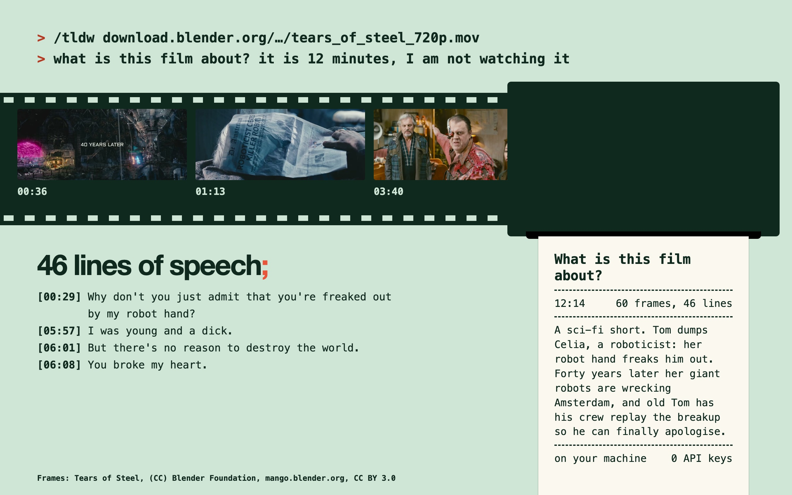

# tldw

A friend sends you a reel. "You have to see this." It is ninety seconds of someone pointing at text bubbles about ten things to buy for your home, and you would like the ten things without the pointing.

`tldw` (too long; didn't watch) is a Claude Code skill that watches the video for you. You hand Claude a link to a Reel, a YouTube video, a TikTok or a local file, ask your question, and get an answer with timestamps. You were never going to watch it anyway.



## Why this exists

Video is a terrible container for information you only want to extract. You can't skim it, you can't search it, and the one sentence you need is always at 7:42, right after the sponsor read.

Claude Code has the opposite problem. It reads text and images very well and cannot open a video at all. Give it a link and it will politely tell you so.

So `tldw` does the boring conversion: it turns the video into frames and text, the two things Claude is good at.

It does this on your machine, with no API keys and no uploads, and it never touches your browser. A skill you install is a stranger's code running inside your agent, so you should be at least a little suspicious of mine. [Security](#security) covers what I did about that.

## Install

You need [`uv`](https://docs.astral.sh/uv/) and `ffmpeg`. On macOS:

```bash
brew install uv ffmpeg
```

Then, in Claude Code:

```
/plugin marketplace add VsevolodEpinetov/tldw
/plugin install tldw@tldw
```

There is no virtualenv to babysit. The script lists its own dependencies, and `uv` installs them the first time it runs.

## Use

Ask the way you would ask a person:

> watch https://www.instagram.com/reel/... and list the books he recommends

Or call it directly: `/tldw:tldw <link or path>`.

A few things it is good for:

- A reel with "ten things to buy for your home" comes back as the ten things, each with the moment it shows up.
- A 40-minute conference talk comes back as the points that matter and where to jump to.
- A recipe video comes back as ingredients and steps in text, which is how recipes should have been delivered in the first place.
- A video in a language you don't speak comes back as the gist in yours.

The first run downloads the Whisper `small` model from Hugging Face and takes a few minutes, enough for a coffee. After that, a one-minute clip takes seconds to download and cut, plus however long your CPU needs to transcribe it.

## How it works

One script, [`skills/tldw/watch.py`](skills/tldw/watch.py), about 280 lines. You can read all of it faster than you can watch most of the videos you'll feed it.

1. `yt-dlp` downloads the video, capped at 720p and 500 MB.
2. `ffmpeg` cuts evenly spaced frames, 16 to 60 depending on the length.
3. Frames that look almost the same as their neighbour get dropped, so Claude doesn't read the same talking head twelve times.
4. `faster-whisper` transcribes the audio on your CPU and skips the silence.
5. Frames, `transcript.md` and `meta.json` land in `~/.tldw/runs/<timestamp>/`, and Claude reads them.

The frames carry what the speech leaves out. Speech gives you "this one is great, this one I'd skip", while the names, prices and titles are usually on the screen.

You can run it without Claude:

```bash
uv run skills/tldw/watch.py "https://www.instagram.com/reel/<id>/"
uv run skills/tldw/watch.py clip.mp4 --lang ru --frames 30
uv run skills/tldw/watch.py --selftest
```

## Login walls

Sooner or later a site will refuse to hand over the video. Instagram wants you logged in for some reels. YouTube, after a couple of downloads from the same address, starts answering "Sign in to confirm you're not a bot", which is a fair question to ask a script.

The safe way out is to download the video yourself and pass the file. That is what I do.

The other way is a cookies file. Export cookies for that one site to a Netscape-format `cookies.txt` with a browser extension and pass it:

```bash
uv run skills/tldw/watch.py "https://www.instagram.com/reel/<id>/" --cookies ~/cookies.txt
```

The script works on a temporary copy and deletes it when the download ends, so your file is left alone. A cookies file is a live login session, so treat it like a password. Sites also restrict accounts that make automated requests, so use a spare account and keep the one with ten years of your photos out of it.

## Security

A skill is someone else's code and someone else's instructions running inside your agent, with access to your files and your shell. That should make you uneasy.

I kept this one small enough to read in one sitting, and I run it through [NVIDIA SkillSpector](https://github.com/NVIDIA/SkillSpector), a scanner built for this question. The static scan gives a risk score of 16 out of 100, recommendation `SAFE`, with 100% coverage, and CI repeats it on every push, so I can't quietly make it worse. The scan with LLM semantic analysis gives the same score and no additional findings. What remains is two medium findings for calling `ffmpeg` through `subprocess` (argument lists, no shell) and one low finding for the permissions the skill declares.

The full reports are in [`docs/`](docs/). Don't take my word for the numbers; run the scanner yourself.

Some things the skill leaves alone on purpose. It stays out of your browser's cookie store and never goes looking for credentials; the only login material it touches is a cookies file you pass yourself with `--cookies`. Audio, frames and transcripts stay on your machine, because transcription is local. Environment variables go unread.

The caption, the transcript and the text on screen are written by whoever made the video. The skill tells Claude to treat all of it as data about the video and to ignore any instructions it finds there.

## Limits

- Videos behind a login wall are not downloaded unless you help. See [Login walls](#login-walls).
- Whisper `small` mishears things, mostly names. The frames usually save it, because the name is on the screen.
- Language auto-detection is shaky on very short clips. Pass `--lang`.
- Tested on macOS with Apple Silicon. Linux should work. Windows is untested.

## Credits

The demo frames are from [Tears of Steel](https://mango.blender.org/), (CC) Blender Foundation, licensed under CC BY 3.0.

## License

MIT
